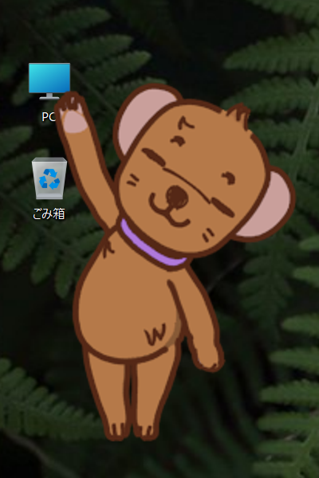

# milligram image viewer ver.3.4.2

A multimedia viewer with no UI. **A Windows image viewer that displays only your images and videos on the desktop.**

Free for non-commercial use only. Commercial use is permitted with a purchased license (see [License](#license) for details).

---

## Who it's for

- Anyone who wants to keep a "favorite image collection" pinned to their desktop (lock feature included)
- Anyone who wants to display images simply
- Anyone who wants to organize a large collection of image files
- Anyone who wants to manage video and music files the same way
- Slideshow

---

## Quick Start

1. Unzip the archive and launch `milligram.exe`
2. Drag and drop image files, folders, or shortcuts onto the window
3. **Right-click** the display area to open the menu

That's all it takes to view your images.

Select All Menus → Options → Associate with file extensions

to make it even more convenient to use.

---

## Key Features

### Alpha channel support

- Supports transparent PNG / WebP / GIF / AVIF.

### Minimal appearance

Only the image itself is displayed.

### Flexible display

Display at any angle, not just in 90° increments. Can be displayed semi-tranparently.
Works well as a reference viewer.
There's also a feature to magnify only part of an image (PeepMode).

### Wide format support

| Type | Supported |
|---|---|
| Still images | JPEG / PNG / GIF / BMP / TIFF / WebP / AVIF (including HDR) |
| Animation | GIF / WebP / AVIF |
| Video | MP4 / MKV and other Media Foundation–supported codecs |
| Archive | ZIP (page through the images inside directly) |
| Plugin | Susie plugins (.spi) supported |

### Animation and video playback

GIF / WebP / AVIF animations and MP4 and other videos can be handled with the same UI as images (rotation, zoom, duplicate window).

### File organization

- **Move files with Ctrl + right-click**: move the current file to another folder with a single click while browsing
- **Homephas integration**: using the auxiliary tool "顔&画像" (Face & Image) for person identification, the destination folder can be selected automatically
- **Favorites list**: save and recall file lists

### Multi-window

Multiple image viewers can be synchronized to advance through images together.

### Instance feature

By saving the config file under a different name, you can run multiple milligram instances with different settings at the same time.
Example: one set to "always on top + locked + slideshow" for desktop decoration, and another used as a normal viewer.

### Slideshow

Automatically advance to the next image or video at a set interval. Continuous playback by folder or by archive.

---

## Quick Reference

### Mouse

| Action | Behavior |
|---|---|
| Left drag | Move the window |
| Right click | Menu |
| Wheel | Switch to previous / next image |
| Right click + wheel | Zoom in / out |
| Left click + wheel | Rotate |
| Double click | Show file list / show image |
| Ctrl + right click | File destination menu |

### Keyboard (common)

| Key | Behavior |
|---|---|
| `↑` `↓` / `Space` | Previous / next image |
| `O` | Open file |
| `P` | Open folder |
| `D` | Start / stop slideshow |
| `F` | Fullscreen |
| `F5` / `R` | Reload |
| `BackSpace` | Close archive |
| `Esc` | Quit |

### During video playback

| Key | Behavior |
|---|---|
| `Z` | Play / pause |
| `←` / `→` | Skip back / forward 10 seconds |
| `Ctrl` + `+` / `-` | Volume up / down |

| `M` | Toggle mute |

For the full list of operations and shortcuts, see the [manual](./documents/manual.en.md).

### PeepMode
Operate the window while holding the Shift key.

---

## Download

Download the latest ZIP from [DOWNSPADE.](http://www.downspade.com), unzip it, and launch `milligram.exe`.

**System requirements:** Windows 10 / 11 (64-bit)

---

## License

milligram image viewer is **freeware for non-commercial use only**. Commercial use requires a separate license (¥3,000 per license).

License purchase / inquiries:
- DOWNSPADE.
- downspade(a)downspade.com (replace `(a)` with `@`)
- http://www.downspade.com

The author assumes no responsibility whatsoever for any damages arising from the use of this software.

For details, see the [manual](documents/manual.en.md).

---

## Documentation

- [Manual (Japanese)](./documents/manual.ja.md) — full feature details, troubleshooting, config files
- [Manual (English)](./documents/manual.en.md)
- [Changelog](./documents/history.txt)
