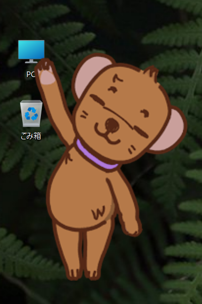

# milligram image viewer ver.3.4.2

UI のないマルチメディアビューワ。**画像や動画だけをデスクトップに表示できます** Windows用の画像ビューワです。

非商用利用のみフリー。商用利用はライセンス購入で可能です（詳細は [ライセンス](#ライセンス) を参照）。

---

## こんな人におすすめ

- デスクトップに「お気に入りの 画像集」を常駐させたい
- 画像をシンプルに表示したい
- 大量に持っている画像ファイルを整理したい
- 動画、音楽ファイルも同様に管理したい
- スライドショー

---

## クイックスタート

1. ZIP を解凍して `milligram.exe` を起動
2. 画像ファイル・フォルダ・ショートカットをウィンドウにドラッグ＆ドロップ
3. 表示エリアを **右クリック** すればメニュー

すべてのメニュー→オプション→拡張子と関連付ける
でダブルクリックで表示されるようになります。

---

## 主な特長

### 画像のアルファチャンネルに対応

- 透過 PNG / WebP / GIF / AVIF に対応しています。

### シンプルな外観

画像本体だけが表示されます

### 柔軟な表示

90° 単位だけでなく、任意角、半透明で表示可能
リファレンスビューワーとしても。
また、画像の一部のみを拡大する機能もあります(PeepMode)。

### 幅広いフォーマット

| 種類 | 対応 |
|---|---|
| 静止画 | JPEG / PNG / GIF / BMP / TIFF / WebP / AVIF（HDR 含む） |
| アニメ | GIF / WebP / AVIF |
| 動画 | MP4 / MKV など Media Foundation 対応コーデック |
| アーカイブ | ZIP（中の画像を直接めくれる） |
| プラグイン | Susie プラグイン（.spi）対応 |

### アニメーション・動画再生

GIF / WebP / AVIF アニメと MP4 等の動画を、画像と同じ UI（回転・拡縮・複製ウィンドウ）で扱えます。

### ファイル整理

- **Ctrl + 右クリックでファイル移動**：閲覧中にクリック一発で別フォルダへ移動
- **Homephas 連携**：顔&画像という補助ソフトを使い人物判定をし移動先フォルダを自動で選択できます
- **お気に入りリスト**：ファイルリストを保存して呼び出し可能

### マルチウィンドウ

複数の image viewer を同期して表示送りすることができます

### インスタンス機能

設定ファイルを別名で保存することで、異なる設定の milligram を同時に動かせます。
例：1 つは「常に最前面 + ロック + スライドショー」でデスクトップ装飾用、もう 1 つは通常のビューワとして使用、など。

### スライドショー

設定した間隔で自動的に次の画像、動画へ。フォルダ・アーカイブ単位で連続再生。

---

## 操作早見表

### マウス

| 操作 | 動作 |
|---|---|
| 左ドラッグ | ウィンドウを移動 |
| 右クリック | メニュー |
| ホイール | 前後の画像へ切替 |
| 右クリック + ホイール | 拡大・縮小 |
| 左クリック + ホイール | 回転 |
| ダブルクリック | ファイル一覧の表示 / 画像表示 |
| Ctrl + 右クリック | ファイル移動先メニュー |

### キーボード（よく使うもの）

| キー | 動作 |
|---|---|
|`↑` `↓` / `Space` | 前 / 次の画像 |
| `O` | ファイルを開く |
| `P` | フォルダを開く |
| `D` | スライドショー開始 / 停止 |
| `F` | フルスクリーン |
| `F5` / `R` | 再読み込み |
| `BackSpace` | アーカイブを閉じる |
| `Esc` | 終了 |

### 動画再生時

| キー | 動作 |
|---|---|
| `Z` | 再生 / 一時停止 |
| `←` / `→` | 10 秒戻し / 進め |
| `Ctrl` + `+` / `-` | 音量上げ / 下げ |
| `M` | ミュート切替 |

すべての操作・ショートカット一覧は [マニュアル](./documents/manual.ja.md) を参照してください。

### PeepMode
Shift キーを押しながらウィンドウ操作

---

## ダウンロード

[DOWNSPADE.](http://www.downspade.com) から最新版の ZIP をダウンロードし、解凍して `milligram.exe` を起動してください。

**動作環境：** Windows 10 / 11（64bit）

---

## ライセンス

milligram image viewer は**非商用利用のみフリーウェア**です。商用利用には別途ライセンスが必要です（1 ライセンス 3,000 円）。

ライセンス購入・お問い合わせ：
- DOWNSPADE.
- downspade(a)downspade.com（`(a)` を `@` に変えてください）
- http://www.downspade.com

本ソフトウェアの使用によって生じたすべての損害について、作者は一切の責任を負わないものとします。

詳細は [マニュアル](documents/manual.ja.md) を参照してください。

---

## ドキュメント

- [マニュアル（日本語）](./documents/manual.ja.md) — 全機能の詳細・トラブルシュート・設定ファイル
- [Manual (English)](./documents/manual.en.md)
- [変更履歴](./documents/history.txt)
